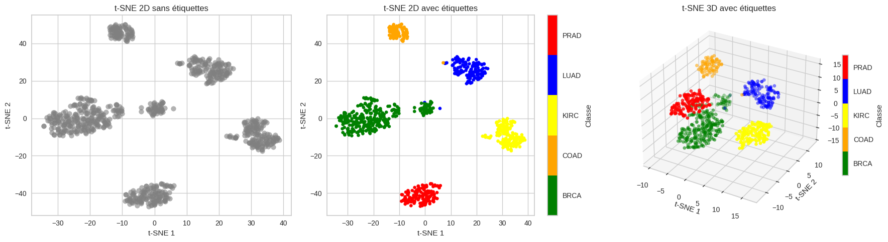
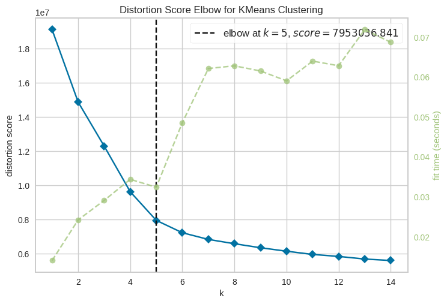
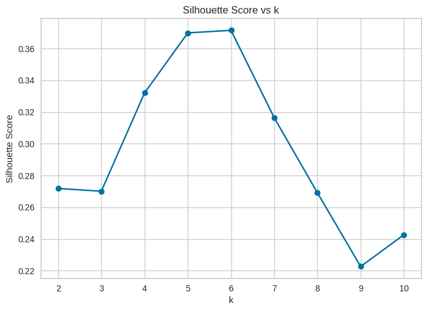
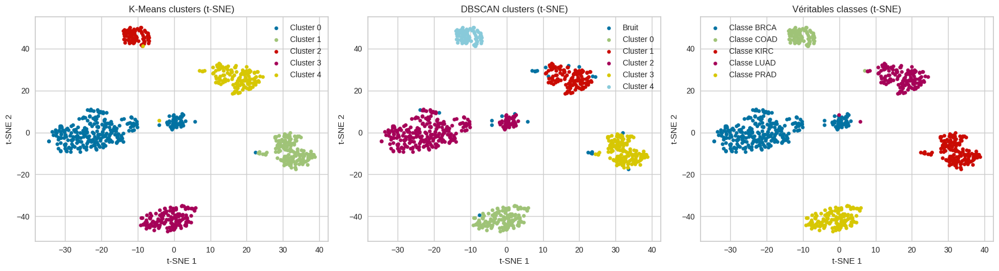

<h1 align="center">RNA-Seq Pan-Cancer Clustering for Tumor Identification</h1>

<p align="center">
  Unsupervised clustering of tumour gene-expression profiles with K-means and DBSCAN.
</p>

<p align="center">
  <a href="https://colab.research.google.com/github/anyantudre/RNA-Seq-Pan-Cancer-Clustering-for-Tumor-Identification/blob/main/clustering-rna-seq-avec-k-means-et-dbscan.ipynb"></a>
  
  
  <a href="LICENSE"></a>
</p>

The notebook groups 801 tumour samples from the TCGA Pan-Cancer RNA-Seq data into clusters without looking at their cancer type, then checks the clusters against the five real tumour types. I wrote it in May 2025 as a practical assignment for a course on fuzzy systems and unsupervised classification. The notebook text is in French.

<p align="center">
  
</p>

*t-SNE of the 801 samples, computed on 30 PCA components. Left: what the clustering sees. Middle and right: the same points coloured by tumour type.*

## Data

The [Gene Expression Cancer RNA-Seq](https://archive.ics.uci.edu/dataset/401/gene+expression+cancer+rna+seq) dataset from the UCI Machine Learning Repository is a sample of the TCGA Pan-Cancer HiSeq data. It has 801 samples, each with the expression of 20,531 genes and one of five tumour types:

| Code | Tumour type | Samples |
|---|---|---:|
| BRCA | Breast invasive carcinoma | 300 |
| KIRC | Kidney renal clear cell carcinoma | 146 |
| LUAD | Lung adenocarcinoma | 141 |
| PRAD | Prostate adenocarcinoma | 136 |
| COAD | Colon adenocarcinoma | 78 |

The labels are only used at the end, to check the clusters. The data files are not in this repository.

## Approach

1. **Dimensionality reduction.** PCA down to 30 components, then t-SNE (2D and 3D) on those 30 components for the plots.
2. **K-means.** Runs for k = 2 to 7, the elbow method (Yellowbrick and `KneeLocator`) for k = 1 to 14, and the silhouette score for k = 2 to 10.
3. **DBSCAN.** A grid over `eps` (1 to 150) and `min_samples` (3, 5, 8) on the 30 PCA components, then `eps` estimated from the knee of a 5-nearest-neighbour distance plot.
4. **Comparison.** K-means clusters, DBSCAN clusters and the real tumour types side by side, in PCA and t-SNE space.

## Results

| Method | Setting | Clusters | Silhouette |
|---|---|---:|---:|
| K-means | k = 5 (elbow) | 5 | 0.370 |
| DBSCAN | `eps` = 100.3, `min_samples` = 5 (best of the grid) | 5 | 0.362 |
| DBSCAN | `eps` = 111.8, `min_samples` = 8 | | 0.366 |

The elbow falls at k = 5, the number of tumour types. The silhouette score is about 0.37 at both k = 5 and k = 6, so the elbow settled the choice. The k-distance plot put `eps` at 111.0. With that value and `min_samples` = 5, DBSCAN finds 5 clusters plus a set of points it marks as noise.

<p align="center">
  
  
</p>

<p align="center">
  
</p>

In the t-SNE view, the K-means clusters line up with the five tumour types, and DBSCAN finds the same groups while leaving scattered samples as noise. KIRC and PRAD stand apart in every projection. In 2D PCA, BRCA and LUAD overlap, which the notebook reads as similar expression profiles.

Some limits:

- The clusters are compared with the labels by eye. The notebook does not compute an external score such as the adjusted Rand index.
- The 30 PCA components are fitted on the raw expression values. A standardised matrix is computed but not used for them.
- The notebook text says 881 samples in a few places; the data has 801.

## Run it

```bash
pip install "scikit-learn<1.7" numpy pandas matplotlib seaborn kneed yellowbrick jupyter
```

`scikit-learn` is pinned below 1.7 because the notebook calls `TSNE(n_iter=...)`, which newer releases renamed to `max_iter`.

Download the dataset from the [UCI page](https://archive.ics.uci.edu/dataset/401/gene+expression+cancer+rna+seq) and extract `data.csv` and `labels.csv`. The notebook reads them from a Kaggle input folder, so change the two paths in the first data cell to where you put them, then run the cells in order. A CPU is enough.

## Repository layout

```
├── clustering-rna-seq-avec-k-means-et-dbscan.ipynb   # the full analysis (in French)
├── media/                                            # charts used in this README
└── LICENSE
```

## Credits

Author: Wendyellé Abubakrh Alban NYANTUDRE.

Dataset: Fiorini, S. (2016). *gene expression cancer RNA-Seq* [Dataset]. UCI Machine Learning Repository. https://doi.org/10.24432/C5R88H. Licensed under CC BY 4.0. The samples come from The Cancer Genome Atlas (TCGA) Pan-Cancer project.

The code is released under the [MIT License](LICENSE).
